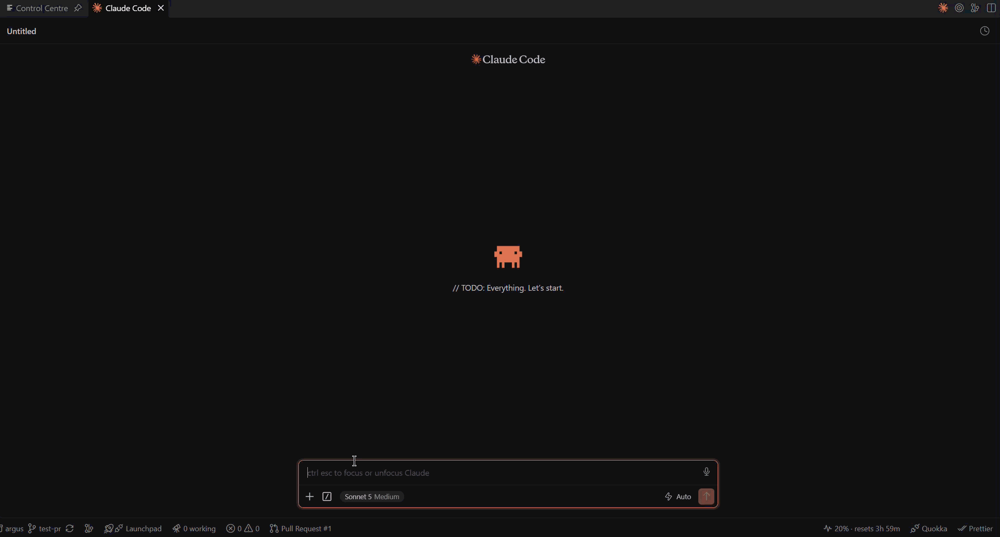

# Argus

Mission control for [Claude Code](https://claude.com/claude-code) in VS Code. See every Claude Code session at a
glance, and know which ones are waiting on you.

- **Sessions board**: every session sorted into **Needs you**, **Working**, **Idle**, **PR open** and
  **Archived**, updating live as Claude works.
- **Notifications**: when a session needs permission, asks a question or finishes, with a button straight to it.
- **PRs and worktrees**: each card shows the PRs and git worktrees the session made, and archives itself once its
  PRs are merged.
- **Diff review**: review a worktree's or PR's changes in Argus chat, comment on lines, and send the comments to
  the session.
- **Plan usage**: your Claude plan usage in the status bar.
- **Plugins**: add your own Control Center tabs, card chips and archive steps through a plugin API.



## Getting started

1. Install Argus, and make sure you have the [requirements](#requirements), in particular Node.js 24 or newer.
2. On first install Argus opens its Welcome page, which shows whether session tracking is set up and how to add
   plugins. Click **Set Up Session Tracking** there, or run **Argus: Set Up Session Tracking** from the command
   palette (or click the link in the empty Sessions view). This installs the Claude Code hooks Argus needs; no sessions appear without it.
3. Start or resume a Claude Code session. It appears in the Argus sidebar after its first prompt. Sessions that
   were already open show up once they next fire a hook. To add earlier chats now, run **Argus: Import Existing
   Claude Chats**: it reads Claude Code's transcripts from the last `argus.sessions.retentionDays` days and adds
   any chat Argus has no record of, as idle or archived.

## Features

### Sessions board

A sidebar view (the Argus icon in the activity bar) groups your Claude Code sessions into **Needs you**,
**Working**, **Idle**, **PR open** and **Archived**. Cards move on their own as session state changes.

- A session stopped mid-turn (Esc, a crash or a closed tab) shows as **interrupted** in **Needs you**, so you know
  to resume it.
- The activity bar badge counts sessions that need you. A status bar item shows how many there are and the longest
  wait; click it to jump to one.
- Open a session's tab from its card. Argus asks the Claude Code extension to reveal the existing tab or resume the
  session.
- Each VS Code window shows only its own sessions: those started in the window's workspace folders, or in any
  checkout or worktree of the same git repo. Set `argus.sessions.scope` to `all` to see every session in every
  window. A window with no folder open shows everything.
- A card's title is the session's first prompt. Double-click the title (or use **Rename Chat**) to rename it in
  Argus. Claude Code's `/rename` also works, and changes the name in `/resume` and for other sessions too.
- Cards show open PRs. A `+ 2 merged · 1 closed` chip shows the merged and closed ones too; click it again to
  hide them.
- Keyboard: `/` to search, `j`/`k` to move, `Enter` to open, `e` to archive, `x` to select for bulk actions, `Esc`
  to clear the selection, `n` for a new chat.

**Archiving.** A session archives itself when every PR it created is merged or closed, or when it closes without
making a PR. You can also archive by hand. When the session has worktrees, archiving offers to remove them, shows
how many uncommitted files each one has, and offers a force removal that deletes those files. Installed plugins
can add their own cleanup steps; you are asked first. Sending a new prompt to an archived session brings it back.

**Notifications.** A warning when a session needs permission or asks a question, and an info message when it
finishes. The **Open Session** button jumps straight to the session. Set `argus.notifications` to `input`
(permission and questions only) or `off`.

### Control Center

Run **Argus: Open Control Center** for the full-size view. It holds the Sessions tab, a tab for each
installed plugin, and a Settings tab. On top of the sidebar, the Sessions tab has:

- Columns side by side. Press `g` (or click **by repo**) to split them into one row per repo, with repos that
  need you first.
- Token use on each card: `ctx` is the size of the latest prompt (how full the context is), `used` is new input,
  cache writes and output summed over the session and its sub-agents, plus how many times it was compacted.
- Search through every prompt and reply in each session's transcript, archived sessions included, with the
  matching text shown on the card. It starts at three characters.
- The sub-agents running in each session, by type.
- Multi-select for bulk archiving: ctrl/⌘-click cards, shift-click for a range, or press `x` on the selected card.
  A bar shows how many are picked with **Archive** (or `e`), **Unarchive**, **Select all shown** and **Clear**
  (`Esc`). Worktree and plugin cleanup for the whole batch is offered in one prompt.

### Settings tab

**Argus: Settings** (`argus.openSettings`) opens the Control Center on a Settings tab that edits every Argus
setting, Chat first. Toggles, dropdowns (with each option's description), text and number fields save to your
user settings as you change them. **Reset** removes your value, and a note shows when a workspace setting
overrides it. Object and list settings open `settings.json`; **Open in VS Code Settings** opens the standard
Settings UI filtered to Argus.

### Diff review

Needs Argus chat (`argus.chat.enabled`).

- A card with a worktree gets a `± <worktree>` chip; a card with an open PR gets `± #<number>`. Click either to
  open the session's chat with that diff in its review panel.
- Comment on lines and send the comments to the agent from the review panel.

### Argus chat (beta)

Off by default. Turn on `argus.chat.enabled` to open Claude Code sessions in Argus's own chat panel instead of
the Claude Code extension's tab. It runs your installed `claude` through the [Claude Agent SDK](https://docs.claude.com/en/docs/agent-sdk/overview),
so it uses your existing Claude Code sign-in, settings and hooks. Sessions started here appear on the board like any other.

- **Argus: New Chat** starts a chat. Opening a card from the board resumes its session in the chat.
- **Argus: Open Chats Side by Side** shows several chats in a grid, each with its transcript and a message box.
  Tiles that need you are outlined. Add, remove or expand a tile from its header.
- Permission requests, questions and plan approvals appear inline in the chat.
- On the Control Center Sessions tab, a card waiting on a permission or question from an Argus chat expands in
  place: **Allow once**, **Always allow** or **Deny**, or choose an option and **Send answer**. Plan approvals
  open the chat. **add to grid** on a card adds its chat to the side-by-side view.
- **+ Agent** in a chat's header starts another chat in the same folder (optionally with a first message) and
  opens the group in the grid. Agents in a group share one Sessions card: it sits in the column of its most urgent
  agent, lists each agent with its status, and opens them all side by side when clicked (the first agent's chat if
  chat is off). Archiving the card archives every agent. Groups are stored in `~/.claude/argus/board.json`
  (`groupOf`).

`argus.chat.claudePath` sets the `claude` executable (empty: `claude` on your PATH, then `~/.local/bin`, then the
Claude Code extension's copy). New chats take their model, effort and permission mode from your Claude Code settings (`model`, `effortLevel`, `permissions.defaultMode`); a reopened chat keeps the model and effort last picked in it.

### Claude plan usage

A status bar item showing your Claude plan usage as a percentage (amber at 75%, red at 90%). It is on by default;
turn it off with `argus.usage.enabled`.

It reads the sign-in that Claude Code stores locally (`~/.claude/.credentials.json`, or the macOS keychain) and
sends it only to Anthropic's undocumented usage endpoint (`https://api.anthropic.com/api/oauth/usage`). The token
is not stored, cached or logged. Usage refreshes every `argus.usage.refreshMinutes` minutes (default 5). Check
Anthropic's terms on using your Claude subscription sign-in with third-party tools.

## Plugins

A plugin adds a tab to the Control Center, chips to session cards, or extra steps when a session is archived.
Plugins are folders in `~/.claude/argus/plugins` that Argus loads on startup; nothing is installed into VS Code.

### Installing one

Put the plugin's folder in the plugins folder and build it. For a plugin in a git repo:

macOS and Linux:

```bash
mkdir -p ~/.claude/argus/plugins && cd ~/.claude/argus/plugins
git clone <plugin repo url> my-plugin
cd my-plugin && npm install && npm run build
```

Windows (PowerShell):

```powershell
New-Item -ItemType Directory -Force "$HOME\.claude\argus\plugins" | Out-Null
Set-Location "$HOME\.claude\argus\plugins"
git clone <plugin repo url> my-plugin
Set-Location my-plugin; npm install; npm run build
```

Then run **Argus: Reload Plugins**. Argus asks once per folder before loading a plugin for the first time,
because a plugin runs with the same access to your machine that Argus has.

To update a plugin, run `git pull`, `npm install` and `npm run build` in its folder, then **Argus: Reload
Plugins**.

### Configuring one

Plugin settings live under one key, keyed by plugin id, and work at user or workspace level:

```json
"argus.plugins.config": {
  "my-plugin": { "someSetting": "value" }
}
```

A plugin's manifest sets its defaults and its README should list its keys. `argus.plugins.paths` loads extra plugin folders from anywhere on disk,
which is how you run one straight from a checkout.

### Writing one

See [DEVELOPING.md](DEVELOPING.md#writing-a-plugin) for the API, the manifest and a worked example.

## Requirements

- VS Code 1.90 or newer.
- The [Claude Code extension](https://marketplace.visualstudio.com/items?itemName=anthropic.claude-code), which
  Argus uses to open sessions. Argus relies on its `claude-vscode.editor.open` command and the session registry
  it keeps at `~/.claude/sessions/<pid>.json`. Neither is a documented public API, and both may change.
- [Node.js](https://nodejs.org) 24 or newer. The session tracker hook is a TypeScript file that Node runs
  natively.
- Optional: `git`, for worktrees and diff review.
- Optional: the [GitHub CLI](https://cli.github.com) (`gh`), signed in, for PR status and PR diffs.

## Settings

| Setting | Default | Description |
| --- | --- | --- |
| `argus.sessions.scope` | `window` | `window` shows this window's sessions only; `all` shows every session on this machine. |
| `argus.sessions.prRefreshMinutes` | `1` | How often PR states refresh in the background, for session cards. |
| `argus.sessions.retentionDays` | `30` | Session record files are deleted this many days after the session is no longer open. |
| `argus.notifications` | `all` | Show notifications when a session needs attention: `all` (permission, question or finished), `input` (permission and questions only), or `off`. |
| `argus.prs.cacheSeconds` | `300` | How long a fetched PR state is reused before `gh` is called again. |
| `argus.diffReview.baseRef` | `""` | Base to diff against. Empty uses `origin/HEAD`, then `origin/main`, `origin/master`, `main`, `master`. |
| `argus.diffReview.contextLines` | `3` | Unchanged lines shown around each change. |
| `argus.usage.enabled` | `true` | Show Claude plan usage in the status bar. Turn off to stop reading the Claude Code sign-in. |
| `argus.usage.refreshMinutes` | `5` | How often Claude plan usage refreshes in the background. |
| `argus.chat.enabled` | `false` | Open sessions in Argus's own chat (beta) instead of the Claude Code extension's tab. |
| `argus.chat.claudePath` | `""` | Path to the `claude` executable the chat runs. Empty: `claude` on your PATH, then `~/.local/bin`, then the Claude Code extension's copy. |
| `argus.plugins.config` | `{}` | Settings for locally installed plugins, keyed by plugin id. See [Plugins](#plugins). |
| `argus.plugins.paths` | `[]` | Extra plugin folders to load, on top of everything in `~/.claude/argus/plugins`. |

## Commands

- **Argus: Open Control Center** (`argus.openControlCenter`)
- **Argus: Settings** (`argus.openSettings`)
- **Argus: Welcome** (`argus.welcome`)
- **Argus: Sessions Needing You** (`argus.sessions.showAttention`)
- **Argus: Set Up Session Tracking** (`argus.sessions.installHooks`)
- **Argus: Import Existing Claude Chats** (`argus.sessions.importChats`)
- **Argus: Remove Session Tracking** (`argus.sessions.removeHooks`)
- **Argus: New Chat** (`argus.chat.new`, chat enabled only)
- **Argus: Open Chats Side by Side** (`argus.chat.openGrid`, chat enabled only)
- **Argus: Show Claude Plan Usage** (`argus.usage.show`)
- **Argus: Refresh Claude Plan Usage** (`argus.usage.refresh`)
- **Argus: Reload Plugins** (`argus.plugins.reload`)
- **Argus: Run Plugin Command** (`argus.plugins.runCommand`)
- **Argus: Open Plugins Folder** (`argus.plugins.openFolder`)
- **Argus: Reset Plugin Trust** (`argus.plugins.resetTrust`)

The Sessions view also has toolbar and per-card commands (new chat, refresh, open, rename, mark read,
archive/unarchive, open worktree in a new window) on its icons and context menu.

## What Argus reads and writes

Argus is local-only. It has no telemetry.

| Path | Purpose |
| --- | --- |
| `~/.claude/settings.json` | "Set Up Session Tracking" adds hook entries; "Remove Session Tracking" removes them. A `.bak` copy is written first. |
| `~/.claude/argus/session-tracker.ts` | The hook script, copied out of the extension so updates never break the path in settings. |
| `~/.claude/argus/plugins/` | Plugin folders, loaded on startup. Argus also writes `argus.d.ts` and `argus-webview.d.ts` here for plugin authors. |
| `~/.claude/argus/sessions/<id>.json` | One record per session, written by the hook on SessionStart, UserPromptSubmit, PreToolUse, PostToolUse, PermissionRequest, Notification, Stop, SubagentStart, SubagentStop and SessionEnd. It holds prompt snippets, the last assistant message and any pending tool command in plain text. Deleted `argus.sessions.retentionDays` days after the session closes. |
| `~/.claude/sessions/<pid>.json` | Claude Code's own registry of open sessions (read only). |
| `~/.claude/projects/**/*.jsonl` | Claude Code's session and sub-agent transcripts (read only), for token use and search. Only new lines are read, kept in memory and never written anywhere. |
| `~/.claude/.credentials.json` | Claude Code sign-in (read only, while `argus.usage.enabled` is on, which is the default). Sent only to the Anthropic usage endpoint. |

Network use: `gh` calls to GitHub for PR state and PR diffs, using your existing `gh` login, and the Claude plan
usage call above. A plugin may make its own network calls; see its README.

## Troubleshooting

- **No sessions appear**: run **Argus: Set Up Session Tracking**, check that `node --version` is 24 or newer in a
  terminal, then start a new Claude Code session.
- **Interrupted sessions, sub-agents or a fix to the hook don't show up after updating Argus**: run **Argus: Set
  Up Session Tracking** again to install the latest hook.
- **Sessions stop updating after a Claude Code or VS Code update**: Argus depends on `claude-vscode.editor.open`
  and Claude Code's session registry file, neither of which is a stable public API. If either changes shape,
  opening sessions and session detection can break until Argus is updated.
- **PR status fails**: run `gh auth status`. If `gh` is installed but not found, make sure it is on the PATH VS
  Code was launched with.

## Uninstalling

Uninstalling the extension removes the hook entries from `~/.claude/settings.json` automatically, the same as
running **Argus: Remove Session Tracking** first. Your session records under `~/.claude/argus/sessions` are kept.

## License

MIT.
