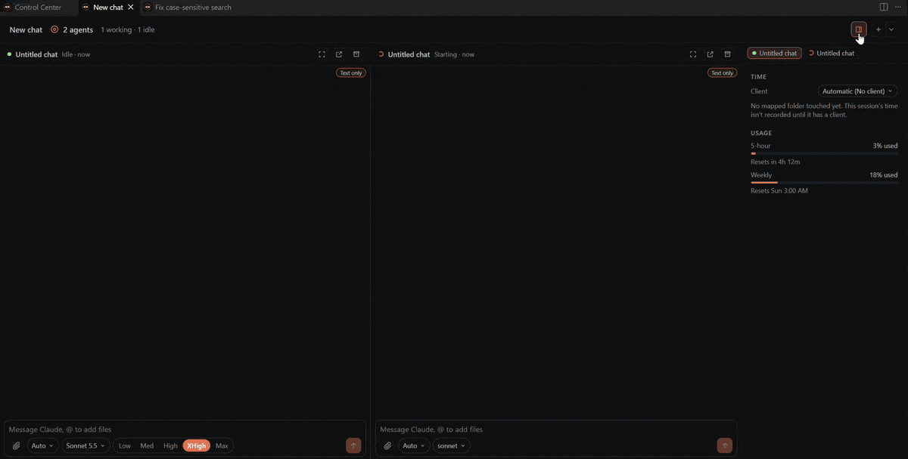

# Agents (experimental)

Run several agents on one task, side by side. Turn on `argus.chat.experimentalMultiAgent` (it can be set per
workspace). With it off, forks open in their own tab and each agent has its own card.

- **+** in a chat's header, or in a group grid's bar, starts another chat in the same folder (optionally with a
  first message) and opens the group in a grid. The arrow next to it adds an existing chat to the group instead.
- Agents in a group share **one Sessions card**: it sits in the column of its most urgent agent, lists each agent
  with its status, and opens them all side by side when clicked. Archiving the card archives every agent.
- **Argus: Open Chats Side by Side** shows several chats in a grid, each with its transcript and a message box.
  Tiles that need you are outlined.
- A **details panel** on the right (changed files, worktrees, PRs, subagents, usage) follows the tile you click or
  the tab you pick; the panel button in the bar hides it.
- Each tile's header can **focus** it (fill the tab with that agent and its details; click again to go back),
  **pop it out** to its own tab, or **archive** it (as its board card would, removing the tile). A lone agent left
  in a grid turns back into a single tab; an empty grid closes.

Groups are stored in `~/.claude/argus/board.json` (`groupOf`).
