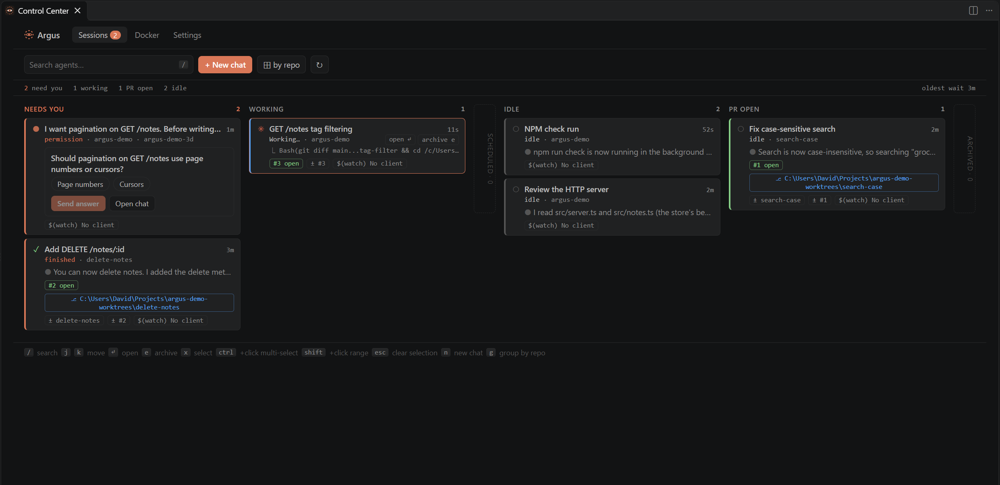

# Control Center

Run **Argus: Open Control Center** for the full-size view. It holds the Sessions tab, a tab for each installed
[plugin](../plugins/index.md), and a Settings tab.

## Sessions tab

Everything the [sidebar](sessions-board.md) has, plus:

- Columns side by side. Press `g` (or click **by repo**) to split them into one row per repo, with repos that need
  you first.
- Search through every prompt and reply in each session's transcript, archived sessions included, with the
  matching text shown on the card. It starts at three characters.
- The sub-agents running in each session, by type.
- Cards waiting on a permission or question from an Argus chat expand in place: **Allow once**, **Always allow** or
  **Deny**, or choose an option and **Send answer**. Plan approvals open the chat.
- Multi-select for bulk archiving: ctrl/⌘-click cards, shift-click for a range, or press `x` on the selected card.
  A bar shows how many are picked with **Archive** (or `e`), **Unarchive**, **Select all shown** and **Clear**
  (`Esc`). Worktree and plugin cleanup for the whole batch is offered in one prompt.

## Settings tab

**Argus: Settings** opens the Control Center on a Settings tab that edits every Argus setting, Chat first, with a
search box that filters them. Toggles, dropdowns (with each option's description), text and number fields save to
your user settings as you change them. **Reset** removes your value, and a note shows when a workspace setting
overrides it. Object and list settings open `settings.json`; **Open in VS Code Settings** opens the standard
Settings UI filtered to Argus. Every setting is listed on the [Settings](../settings.md) page.
