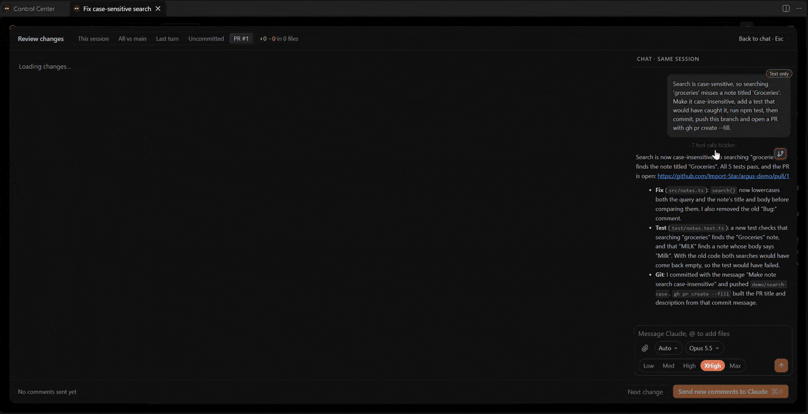

# Diff review

Review what a session changed, comment on lines, and send the comments to the agent.

## Opening it

- **Review changes** in a chat's header.
- **Diff** next to a worktree or PR in the chat's details pane.
- Click a file under **Changed files** in the chat's details pane.

## What you can compare

| Tab | Shows |
|---|---|
| **This session** | The files this session edited, against their repo's base branch. |
| **All vs main** | Everything on the branch against its base (`argus.diffReview.baseRef`). |
| **Last turn** | The files Claude changed in its latest turn. |
| **Uncommitted** | Staged, unstaged and untracked changes. |
| **PR** | A pull request's diff. For PRs in the same repo it's read from your local clone after fetching the PR; `gh` is the fallback. |

Files in a git repo nested inside the session's folder (or outside it) are diffed in their own repo, against that
repo's base.

## Commenting

Click a line to comment on it, then send the comments to Claude. Each comment gets its own thread with Claude's
answer under it. Unchanged lines between changes are folded; click a gap to expand it (small gaps in full, larger
ones 20 lines at a time). Expanded lines can be commented on too.

Long lines wrap. A changed Markdown file has **Show rendered** in its header to read the new version rendered.
Select text to comment on it: the text stays highlighted, the comment shows under that line (list item, table row,
paragraph) and is sent on the source line the text is on. Or click a block to comment on its first line. Blocks
with added lines are highlighted. Comments on deleted lines show at the top. **Show diff** goes back.

`argus.diffReview.baseRef` sets the base branch (empty: `origin/HEAD`, then `origin/main`, `origin/master`, `main`,
`master`) and `argus.diffReview.contextLines` the unchanged lines shown around each change.
