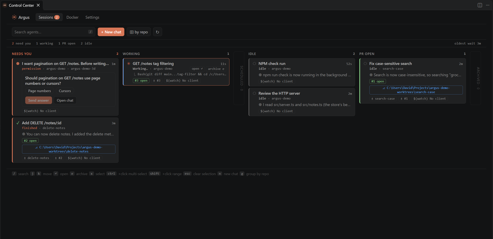

# Argus

Mission control for [Claude Code](https://claude.com/claude-code) in VS Code. See every Claude Code session at a
glance, know which ones are waiting on you, and work with them in Argus's own chat.

- **[Sessions board](features/sessions-board.md)**: every session sorted into **Needs you**, **Working**,
  **Scheduled**, **Idle**, **PR open** and **Archived**, updating live as Claude works.
- **[Argus chat](features/chat.md)**: sessions open in Argus's own chat, with permission prompts, plan approvals,
  rewind, fork and review.
- **[Diff review](features/review.md)**: review a worktree's or PR's changes, comment on lines, and send the
  comments to the session.
- **[Agents](features/agents.md)** (experimental): several agents on one task, side by side.
- **[Notifications](features/sessions-board.md#notifications)**: when a session needs permission, asks a question
  or finishes, with a button straight to it.
- **PRs and worktrees**: each card shows the PRs and git worktrees the session made, and archives itself once its
  PRs are merged.
- **[Plan usage](features/usage-and-keep-awake.md)**: your Claude plan usage in the status bar.
- **[Plugins](plugins/index.md)**: add your own Control Center tabs, card chips, archive steps and chat extensions.

[Get started](getting-started.md){: .btn .btn-primary }
[Install from the Marketplace](https://marketplace.visualstudio.com/items?itemName=importstar.argus-control-center){: .btn }
